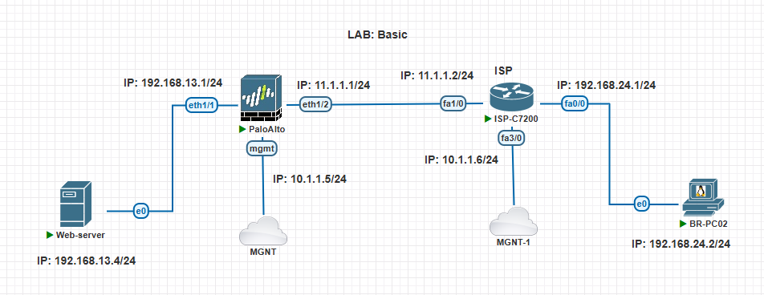
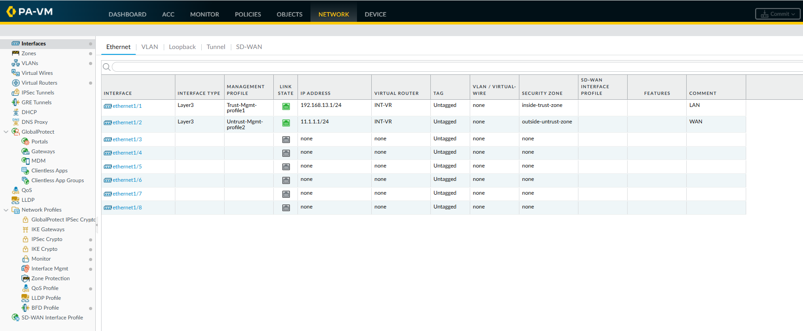
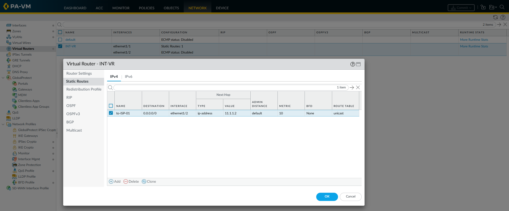

## Basic Configure Palo Alto Firewall:

The default username and password for a Palo Alto Networks firewall are: 
- Username: `admin`
- Password: `admin`


> The firewall forces you to change the default password immediately upon your first login.


### Lab Topology:





---
---


## Configure Router (ISP):

### Configure Router:

```
int f0/0
ip address 192.168.24.1 255.255.255.0
no shutdown
exit

int f1/0
ip address 11.1.1.2 255.255.255.252
no shutdown
exit

int loopback 1
ip address 9.9.9.9 255.255.255.255
no shutdown
exit


ip route 192.168.13.0 255.255.255.0 11.1.1.1
ip route 192.168.14.0 255.255.255.0 11.1.1.1

ip http server
ip http secure-server

ip http port 80
ip http secure-port 443


username admin secret secret123
line vty 0 5
login local
end

exit
```


---
---


## Configure Interfaces on Palo Alto: 

In this lab, configure a Palo Alto Networks firewall using both the Web GUI and CLI, then verify connectivity and troubleshoot common configuration errors.

- **Interfaces**: Connect the firewall to networks and assign IP addresses. Where packets enter and leave the firewall.
- **Zones**: Classify traffic as trusted, untrusted, or belonging to another security domain.
- **Virtual routers**: Maintain routing tables and determine the next hop for traffic. The Layer 3 routing context that selects the outgoing path.


### 1. Configure a Static IP on the Management Interface (CLI):

The management interface uses DHCP by default. Use these steps to transition it to a static IP:

```
configure

set deviceconfig system type static

set deviceconfig system ip-address 10.1.1.5 netmask 255.255.255.0 default-gateway 10.1.1.2 


set deviceconfig system hostname fw-01
set deviceconfig system domain technbd.local
set deviceconfig system timezone Asia/Dhaka


set deviceconfig system dns-setting servers primary 8.8.8.8
set deviceconfig system dns-setting servers secondary 1.1.1.1


commit

run show interface management

exit

show interface management
```


> `HTTPS`, `SSH`, and `ping` are enabled by default on the management port in the standard initial configuration. 


#### Management Console: 

Web GUI via `https://10.1.1.5` or CLI via console/SSH.


_SSH Console:_
```
ssh admin@10.1.1.5
Password:
```


#### Configure Hostname (GUI): 

1. Navigate to: `DEVICE` - `Setup` - `Management` Tab - `General Settings` - click `⚙️`:
    - Hostname: `fw-01`
    - Domain: `technbd.local`
    - Login Banner: 
    - SSL/TLS Service Profile: `None`
    - Time Zone: `Asia/Dhaka`
    - Locale: `en`
    - Date: 
    - Time: 
    - Latitude:
    - Longitude:
        - ✅ Use Hypervisor Assigned MAC Addresses
        - ✅ Tunnel Acceleration
    - Click `OK`


#### Configure DNS (GUI): 

1. Navigate to: `DEVICE` - `Setup` - `Services` Tab - `Services` - click `⚙️`:
    - Update Server: `updates.paloaltonetworks.com`
        - ✅ Verify Update Server Identity
    - DNS Settings:
        - DNS: ✅ `Servers`
        - Primary DNS Server: 8.8.8.8
        - Secondary DNS Server: 1.1.1.1
        - Minimum FQDN Refresh Time (sec): 30
        - FQDN Stale Entry Timeout (min): 1440
    - Click `OK`


---
---


### 2. Configure security zones:

1. Navigate to: `NETWORK` - `Zones` - click `+ Add`:
    - Name: `inside-trust-zone`
    - Log Setting: `None`
    - Type: `Layer3`
    - INTERFACES : N/A
    - Zone Protection:
        - Zone Protection Profile: `None`
        - ❌ Enable Packet Buffer Protection
    - Click `OK`


2. Navigate to: `NETWORK` - `Zones` - click `+ Add`:
    - Name: `outside-untrust-zone`
    - Log Setting: `None`
    - Type: `Layer3`
    - INTERFACES : N/A
    - Zone Protection:
        - Zone Protection Profile: `None`
        - ❌ Enable Packet Buffer Protection
    - Click `OK`


---
---


### 3. Configure the Virtual Router: 

1. Navigate to: `NETWORK` - `Virtual Routers` - click `+ Add`:
    - Router Settings: 
        - Name: `INT-VR`
        - General: N/A
        - Click `OK`


---
---


### 4. Create Management Profile: 

1. Navigate to: `NETWORK` - `Network Profiles` - `Interface Mgmt` - click `+ Add`:
    - Name: `Trust-Mgmt-profile1`
    - Administrative Management Services:
        - ✅ HTTP
        - ✅ HTTPS
        - ✅ SSH
    - Network Services:
        - ✅ `Ping` 
    - Click `OK`

2. Navigate to: `NETWORK` - `Network Profiles` - `Interface Mgmt` - click `+ Add`:
    - Name: `Untrust-Mgmt-profile2`
    - Administrative Management Services:
        - N/A
    - Network Services:
        - ✅ `Ping` 
    - Click `OK`


---
---


### 5. Configure a Static IP on a Traffic/Data Interface (GUI):

#### Configure LAN Interface:

1. Navigate to: `NETWORK` - `Interfaces` - `Ethernet` Tab -  select `ethernet1/1`:
    - Interface Name: `ethernet1/1`
    - Comment: `LAN`
    - Interface Type: `Layer3`
    - Netflow Profile: `None`
    - **Config** Tab: 
        - Assign Interface To:
            - Virtual Router: `INT-VR`
            - Security Zone: `inside-trust-zone`
    - **IPv4** Tab:
        - Type: ✅ `Static` 
        - IP - click `+ Add`:
            - ✅ `192.168.13.1/24`
    - **Advanced** Tab:
        - Other Info:
            - Management Profile: `Trust-Mgmt-profile1`
            - MTU: 
    - Click `OK`


#### Configure WAN Interface:

1. Navigate to: `NETWORK` - `Interfaces` - `Ethernet` Tab -  select `ethernet1/2`:
    - Interface Name: `ethernet1/2`
    - Comment: `WAN`
    - Interface Type: `Layer3`
    - Netflow Profile: `None`
    - **Config** Tab: 
        - Assign Interface To:
            - Virtual Router: `INT-VR`
            - Security Zone: `outside-untrust-zone`
    - **IPv4** Tab:
        - Type: ✅ `Static` 
        - IP - click `+ Add`:
            - ✅ `11.1.1.1/24`
    - **Advanced** Tab:
        - Other Info:
            - Management Profile: `Untrust-Mgmt-profile2`
            - MTU: 
    - Click `OK`





_Configure a Static IP (CLI):_
```
configure


-- Create the zones: 
set zone untrust network layer3 ethernet1/1
set zone trust network layer3 ethernet1/2


-- Create virtual router:
set network virtual-router INT-VR


-- Configure the LAN interface:
set network interface ethernet ethernet1/2 layer3 ip 192.168.13.1/24
set network virtual-router INT-VR interface ethernet1/2


-- Configure the WAN interface:
set network interface ethernet ethernet1/1 layer3 ip 11.1.1.1/24
set network virtual-router INT-VR interface ethernet1/1


commit

run show interface ethernet1/2

exit

show interface ethernet1/2
```


---
---


### 6. Configure Default Gateway to ISP: 

1. Navigate to: `NETWORK` - `Virtual Routers` - select `INT-VR`:
    - Select `Static Routes` - `IPv4` - click `+ Add`:
        - Name: `to-ISP-01`
        - Destination: `0.0.0.0/0`  (<-- Static route for specific DST IP or 0.0.0.0/0 for Internet)
        - Interface: `ethernet1/2`
        - Next Hop: `IP Address`
            - `11.1.1.2`
        - Admin Distance: 10 - 240
        - Metric: 10
        - Route Table: Unicast
        - BFD Profile: `Disable BFD`
        - ❌ Path Monitoring:
        - Click `OK`
    - Click `OK`





_Check Virtual router routes:_
```
show routing route
```


_Check Route to upstream gateway:_
```
test routing fib-lookup virtual-router INT-VR ip 11.1.1.1
```


_Ping upstream gateway:_
```
ping source 11.1.1.1 host 11.1.1.2
```


--- 
--- 


## Create Firewall Policy:

A Palo Alto Security Policy determines whether traffic is allowed or denied based on its source, destination, zones, application, user, service, and other conditions.


### Allow LAN Zone to Internet:

1. Navigate to: `POLICIES` - `Security` - click `+ Add`:
    - General Tab: 
        - Name: `allow-LAN-to-WAN`
        - Rule Type: `interzone` or `universal (default)`
        - Description:
        - Tags: 
        - Group Rules By Tag: `None`
        - Audit Comment: 
    - Source Tab:
        - SOURCE ZONE - click `+ Add` - select `inside-trust-zone`
        - SOURCE ADDRESS - click `+ Add` - select `Any` or `host-13.4` or `host-group-Lan-13` 
        - SOURCE USER: N/A 
        - SOURCE DEVICE: N/A 
    - Destination Tab:
        - DESTINATION ZONE - click `+ Add` - select `outside-untrust-zone`
        - DESTINATION ADDRESS - click `+ Add` - select `Any` or select `specific external IP`
        - DESTINATION DEVICE: N/A
    - Application Tab:
    - Service/URL Category Tab:
        - SERVICE - click `+ Add` - select `Any` or `allow-http-https` or select `custom-service-group`
        - URL CATEGORY - click `+ Add` - select `Any` 
    - Actions Tab:
        - Action Setting:
            - Action: `Allow` | Deny | Drop
        - Profile Setting:
            - Profile Type: `None` or `Profiles` (<-- **Profiles**: Antivirus, Vulnerability Protection, Anti-Spyware, URL Filtering, File Blocking, Data Filtering, WildFire Analysis)
        - Log Setting:
            - ✅ Log at Session Start
            - ✅ Log at Session End
            - Log Forwarding: `None` 
        - Other Settings:
            - Schedule: `None`
            - QoS Marking: `None`
            - ❌ Disable Server Response Inspection
    - Click `OK`


### Allow WAN to LAN Zone:

1. Navigate to: `POLICIES` - `Security` - click `+ Add`:
    - General Tab: 
        - Name: `allow-WAN-to-LAN`
        - Rule Type: `interzone` or `universal (default)`
        - Description:
        - Tags: 
        - Group Rules By Tag: `None`
        - Audit Comment: 
    - Source Tab:
        - SOURCE ZONE - click `+ Add` - select `outside-untrust-zone`
        - SOURCE ADDRESS - click `+ Add` - select `Any` 
        - SOURCE USER: N/A 
        - SOURCE DEVICE: N/A 
    - Destination Tab:
        - DESTINATION ZONE - click `+ Add` - select `inside-trust-zone`
        - DESTINATION ADDRESS - click `+ Add` - select `Any` or select `host-13.4`
        - DESTINATION DEVICE: N/A
    - Application Tab:
    - Service/URL Category Tab:
        - SERVICE - click `+ Add` - select `Any` or `allow-http-https` or select `custom-service-group`
        - URL CATEGORY - click `+ Add` - select `Any` 
    - Actions Tab:
        - Action Setting:
            - Action: `Allow` | Deny | Drop
        - Profile Setting:
            - Profile Type: `None` or `Profiles` (<-- **Profiles**: Antivirus, Vulnerability Protection, Anti-Spyware, URL Filtering, File Blocking, Data Filtering, WildFire Analysis)
        - Log Setting:
            - ✅ Log at Session Start
            - ✅ Log at Session End
            - Log Forwarding: `None` 
        - Other Settings:
            - Schedule: `None`
            - QoS Marking: `None`
            - ❌ Disable Server Response Inspection
    - Click `OK`


---
---


