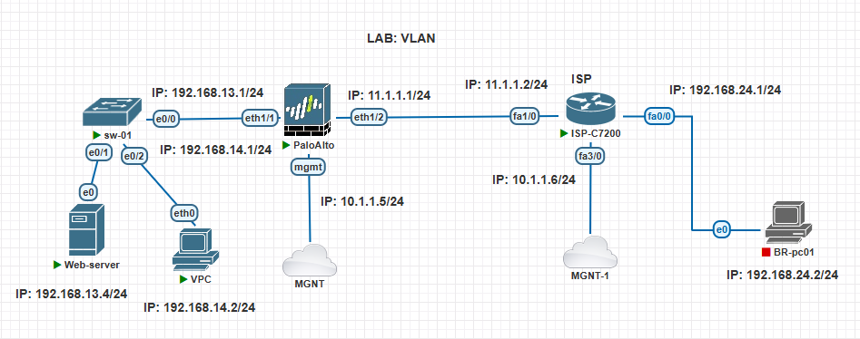
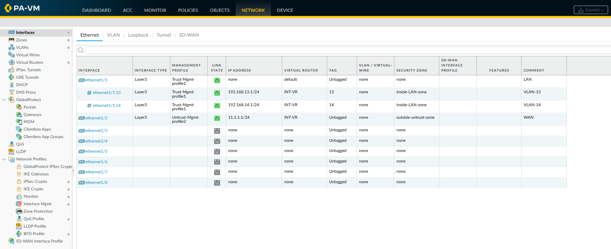

## Configure VLAN:


### Lab Topology:





---
---


## Configure VLAN on Switch:

```
vlan 13
name IT
exit

vlan 14
name MKT
exit


int e0/1
switchport mode access
switchport access vlan 13
exit

int e0/2
switchport mode access
switchport access vlan 14
exit


int e0/0
switchport trunk encapsulation dot1q
switchport mode trunk
switchport trunk allowed vlan 13,14
switchport trunk allowed vlan add 20
exit
```


```
sh vlan brief

sh int trunk
```


---
---


## Configure VLAN on Firewall:


### 1. Configure zones:

1. Navigate to: `NETWORK` - `Zones` - click `+ Add`:
    - Name: `inside-LAN-zone`
    - Log Setting: `None`
    - Type: `Layer3`
    - INTERFACES : N/A
    - Zone Protection:
        - Zone Protection Profile: `None`
        - ❌ Enable Packet Buffer Protection
    - Click `OK`


### 2. Configure VLAN Interface and Sub-interface:

- VLAN to VLAN Communication without Policy on the same zone
- Both VLAN interface on the same Virtual Router 


#### Configure the physical interface:

1. Navigate to: `NETWORK` - `Interfaces` - `Ethernet` Tab -  select `ethernet1/1`:
    - Interface Name: `ethernet1/1`
    - Comment: `LAN`
    - Interface Type: `Layer3`
    - Netflow Profile: `None`
    - **Config** Tab: 
        - Assign Interface To:
            - Virtual Router: `INT-VR`
            - Security Zone: `None`
    - **IPv4** Tab:
        - Type: ✅ `Static` 
        - IP: N/A            (<-- No IP Address set)
    - **Advanced** Tab:
        - Other Info:
            - Management Profile: `Trust-Mgmt-profile1`
            - MTU: 
    - Click `OK`


#### Create VLAN 13 & 14 Sub-interface:

1. Navigate to: `NETWORK` - `Interfaces` - `Ethernet` Tab -  select `ethernet1/1` - click `Add Subinterface`:
    - Interface Name: `ethernet1/1` . `13`
    - Comment: `VLAN-13`
    - Tag: `13`
    - Netflow Profile: `None`
    - **Config** Tab: 
        - Assign Interface To:
            - Virtual Router: `INT-VR`
            - Security Zone: `inside-LAN-zone`
    - **IPv4** Tab:
        - Type: ✅ `Static` 
        - IP - click `+ Add`:
            - ✅ `192.168.13.1/24`
    - **Advanced** Tab:
        - Other Info:
            - Management Profile: `Trust-Mgmt-profile1`
            - MTU: 
    - Click `OK`


2. Navigate to: `NETWORK` - `Interfaces` - `Ethernet` Tab -  select `ethernet1/1` - click `Add Subinterface`:
    - Interface Name: `ethernet1/1` . `14`
    - Comment: `VLAN-14`
    - Tag: `14`
    - Netflow Profile: `None`
    - **Config** Tab: 
        - Assign Interface To:
            - Virtual Router: `INT-VR`
            - Security Zone: `inside-LAN-zone`
    - **IPv4** Tab:
        - Type: ✅ `Static` 
        - IP - click `+ Add`:
            - ✅ `192.168.14.1/24`
    - **Advanced** Tab:
        - Other Info:
            - Management Profile: `Trust-Mgmt-profile1`
            - MTU: 
    - Click `OK`





---
---

